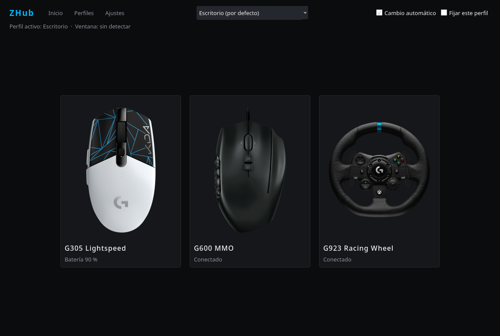
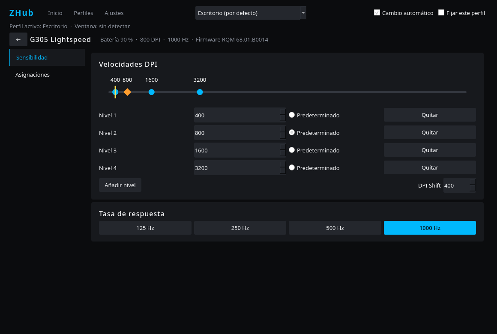
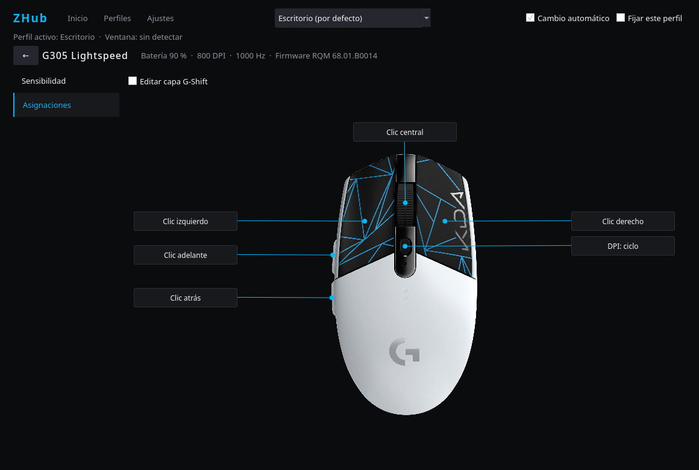
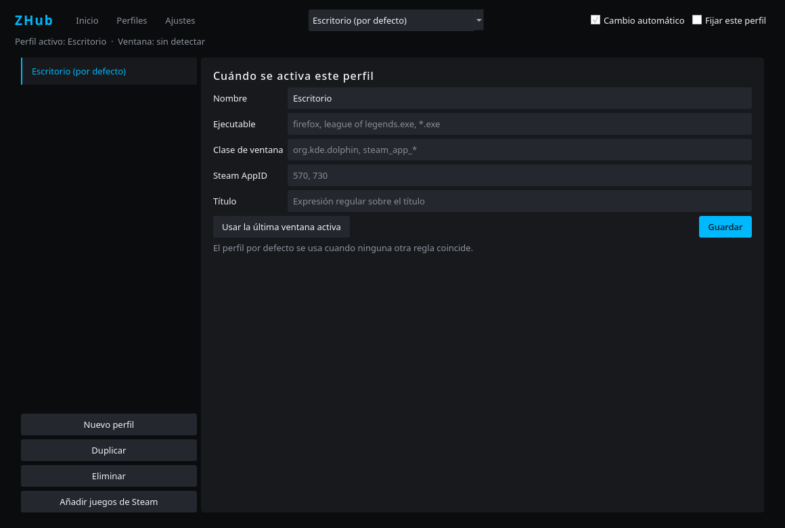
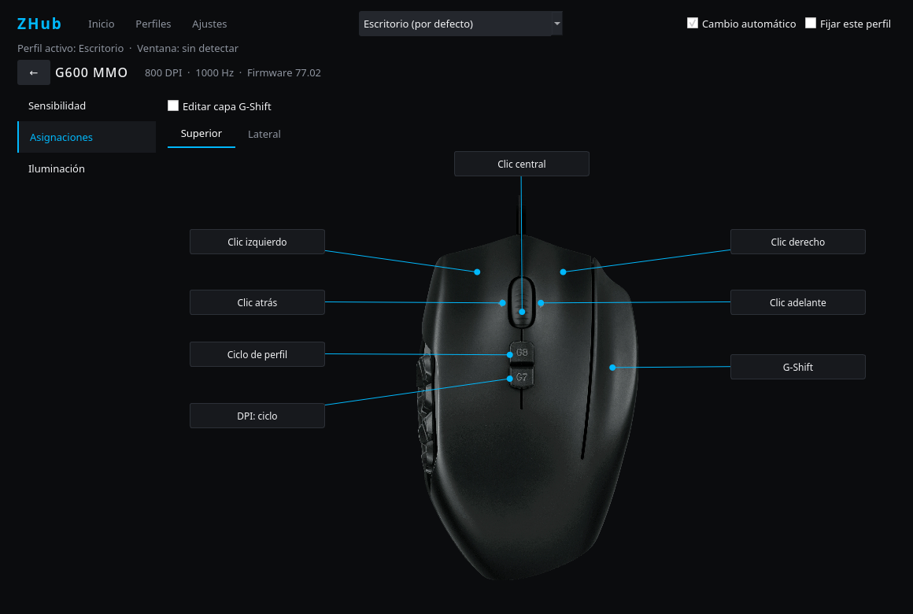
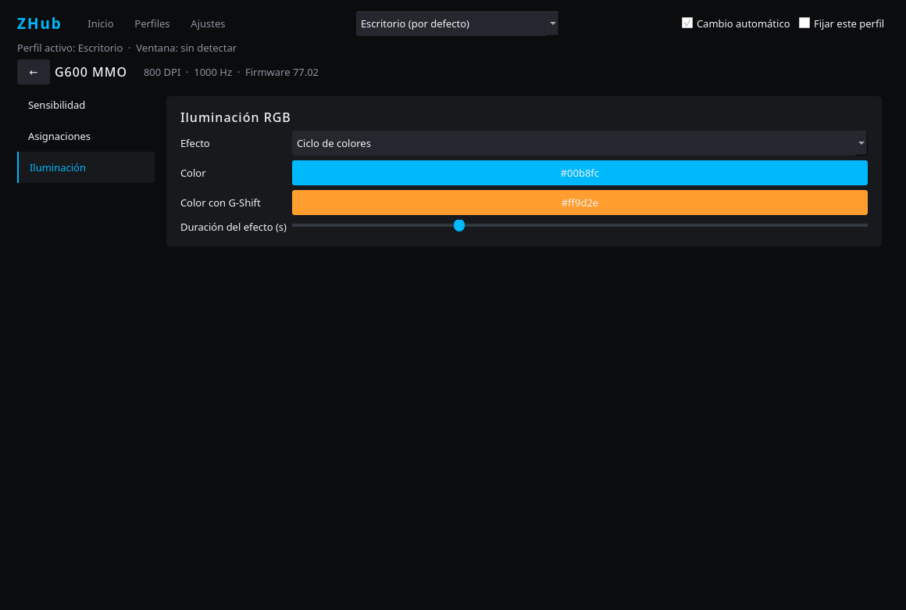
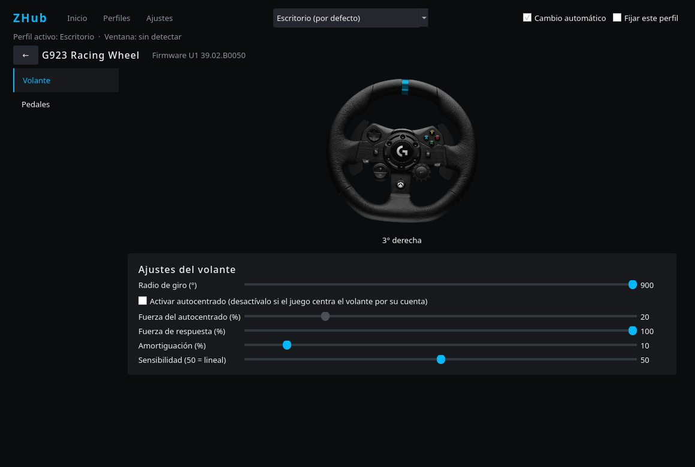
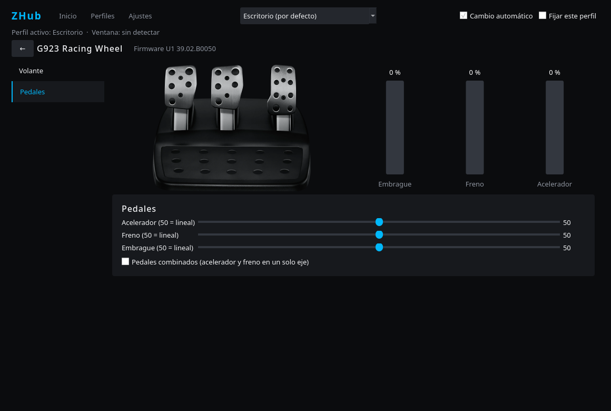

# ZHub

Perfiles por aplicación y configuración de periféricos Logitech en Linux, inspirado en el funcionamiento de G HUB en Windows.

> **Estado del proyecto: temprano.** El **G305 Lightspeed** se ha probado con hardware real.
> El **G600** y el **G923 Xbox** se han probado **solo en parte** (ver la tabla) y todavía no dentro de un juego.
> El **resto de periféricos Logitech no están verificados** y no aparecerán en ZHub.



## Compatibilidad

| Dispositivo | Estado | Funciones |
|---|---|---|
| G305 Lightspeed | **Probado** | DPI, DPI Shift, 125–1000 Hz, botones, G-Shift, batería, firmware |
| G600 MMO | **Parcial** | Probados G6–G9 y G-Shift. Falta comprobar a simple vista DPI, tasa de respuesta y RGB. Usa el tercer modo de memoria del ratón; los dos de G HUB no se tocan |
| G923 Xbox | **Parcial** | Probados el radio de giro, el firmware, la lectura en vivo de volante y pedales y los pedales combinados. Falta probar en juegos el autocentrado, la fuerza, la amortiguación y las curvas |
| Otros Logitech | **No verificados** | No soportados |

Probado en CachyOS con KDE Plasma 6 sobre Wayland. La detección de ventana activa usa KWin, así que otros escritorios no cambian de perfil automáticamente.

### Juegos nativos y Proton

ZHub reconoce el perfil por ejecutable, por el `.exe` que corre bajo Proton, por clase de ventana, Steam AppID o título. Botones, macros, DPI y tasa de respuesta no dependen de cómo se ejecute el juego. **Aún no se ha probado con juegos reales.**

Las curvas y los pedales combinados del G923 usan un volante virtual; algunos juegos con Proton podrían ignorarlo o ver dos volantes. Si no se usan esas opciones, el juego accede al volante real. Algunos antitrampas pueden rechazar macros o dispositivos virtuales.

Si el radio de giro del G923 deja de aplicarse, el controlador puede tener su cola de órdenes atascada (`journalctl -k -b | grep -c "command queue"` da un número alto). Desconectar y volver a conectar el volante la vacía.

## Funciones

- Cambio automático de perfil, perfil fijo y perfil por defecto.
- Solo se muestran los dispositivos conectados, y detecta apagado y encendido.
- Asignaciones sobre la imagen del dispositivo y capa G-Shift.
- Macros (una vez, mantener, alternar) con grabación.
- Importación de perfiles, botones y macros desde una instalación de G HUB en una partición de Windows.
- Alta de perfiles para los juegos de Steam instalados.
- Volante y pedales del G923 en tiempo real.
- Autocentrado activable por perfil, para juegos que centran el volante por su cuenta.
- Aviso cuando el G HUB instalado trae un firmware más nuevo; la actualización se hace desde Windows.

Las imágenes de los dispositivos no se incluyen en el proyecto: ZHub las lee de tu propia instalación de G HUB. Sin ella, muestra una lista de botones.

No incluye scripts Lua, integraciones con OBS, Discord u Overwolf, ni ajustes de Trueforce. G HUB solo trae paquete de firmware del G923, por lo que el G305 y el G600 no muestran aviso.

## Instalación

Requiere Python 3.11 o superior, `python-pyqt6`, `python-evdev` y pertenecer al grupo `input`.

```bash
git clone https://github.com/marcedpr45/ZHub-Logitech-GHub-for-linux.git
cd ZHub-Logitech-GHub-for-linux
./install.sh
```

Para DPI, tasa de respuesta, batería y el radio de giro hace falta una regla udev:

```bash
sudo install -m644 70-zhub.rules /etc/udev/rules.d/
sudo udevadm control --reload
sudo udevadm trigger --subsystem-match=hidraw
```

Arranca ZHub desde el menú o con `zhub` (`--minimized` para ir a la bandeja, `--verbose` para ver el registro). La configuración se guarda en `~/.config/zhub/config.json`.

## Capturas

| Sensibilidad | Asignaciones |
|---|---|
|  |  |



| G600: asignaciones | G600: iluminación |
|---|---|
|  |  |

| G923: volante | G923: pedales |
|---|---|
|  |  |

## Desarrollo

```bash
python3 -m unittest tests.test_core
```

## Licencia

GPL-3.0-or-later. Consulta [LICENSE](LICENSE).

## Aviso legal

ZHub es un proyecto independiente, sin relación con Logitech ni respaldado por esta empresa. Logitech, G HUB y los nombres de producto son marcas de sus propietarios.
